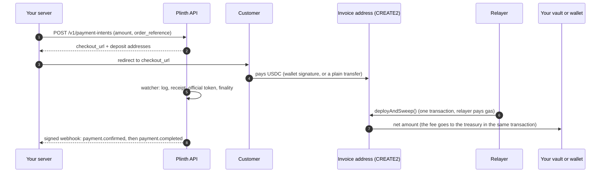
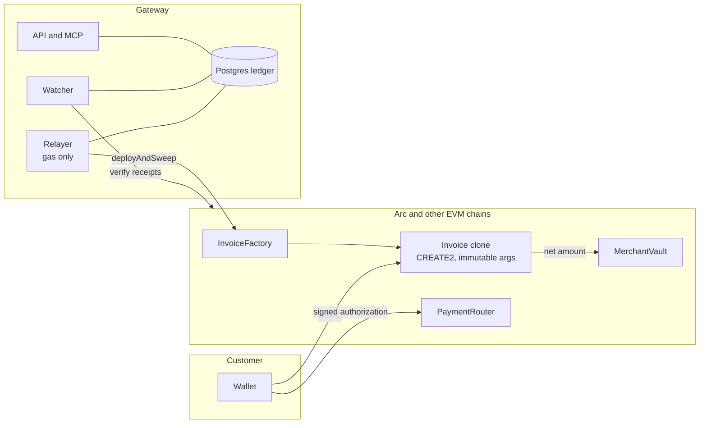

<div align="center">

# Plinth

**Non-custodial stablecoin payments. Get paid in USDC and EURC, wherever you already sell.**

A payment gateway where every payment gets its own address, the chain proves the payment, and the money goes to **your** vault or **your** wallet. Built on **Arc**.

[**Live site**](https://plinth.zerolayer.online) · [**MCP server**](docs/mcp.md) · [**Docs**](docs/README.md) · [**API guide**](docs/api-guide.md) · [**Contracts**](#smart-contracts) · [**Arc mainnet**](#live-on-arc-mainnet) · [**Arc testnet**](#live-on-arc-testnet)


</div>

---

## Contents

1. [Why Plinth](#why-plinth)
2. [How a payment works](#how-a-payment-works)
3. [Features](#features)
4. [Smart contracts](#smart-contracts)
5. [Live on Arc mainnet](#live-on-arc-mainnet)
6. [Live on Arc testnet](#live-on-arc-testnet)
7. [Three ways to be paid](#three-ways-to-be-paid)
8. [Fees](#fees)
9. [AI-native: the hosted MCP server](#ai-native-the-hosted-mcp-server)
10. [Networks and tokens](#networks-and-tokens)
11. [Architecture](#architecture)
12. [Repository layout](#repository-layout)
13. [Quick start](#quick-start)
14. [Deploying contracts](#deploying-contracts)
15. [Quality: what was tested](#quality-what-was-tested)
16. [Security and status](#security-and-status)
17. [Documentation](#documentation)

## Why Plinth

Accepting stablecoins usually means one of two compromises: a custodial processor that holds your balance, or a hand-rolled "send to this wallet" page where you match transfers to orders yourself.

Plinth removes both. Each order gets a **unique deposit address that exists before any contract does** (a counterfactual CREATE2 address), so there is nothing to fund and nothing to babysit. A watcher verifies the transfer on-chain, and a restricted relayer pays the gas to sweep it to its destination. The gateway holds **no key that can move merchant funds**.

- **For merchants:** one API call per order, a hosted checkout, signed webhooks, payment links and invoices, a dashboard, and your money lands in an account you control.
- **For customers:** pay from a connected wallet with one gasless signature (EIP-3009), or just send USDC to the address or QR code.
- **For developers and AI assistants:** a REST API, a hosted [MCP server](#ai-native-the-hosted-mcp-server) with 29 tools, and `llms.txt`.

## How a payment works



The address is **computed offline** and cross-checked against the deployed factory's `predict()` before a customer ever sees it. `sweep()` takes no arguments, so nobody, including the gateway, can choose a recipient.

## Features

| | |
| --- | --- |
| **Payments** | Unique address per payment per network, partial / repeated / late / over / wrong-token payments handled, reorgs reversed, expiry (20 minutes by default) |
| **Checkout** | Hosted page, wallet checkout (gasless, EIP-3009) and address / QR checkout, live status from the backend only |
| **Merchant tools** | Payment links, numbered invoices, refunds verified on-chain, webhooks (signed, retried, idempotent), ledger, settlements, audit log, team roles |
| **Tokens** | USDC on every network, EURC on Arc, each with its own contract set and vault |
| **Payout modes** | Vault, direct to your own wallet, or (operator opt-in) custodial |
| **Fee** | 0.20% by default, capped at **1% by the contract**, taken inside the settlement transaction |
| **AI-native** | Hosted MCP server (29 tools), `llms.txt`, integration playbook, ready prompts |
| **Reliability** | Idempotent API, persisted raw transactions, fee replacement, nonce recovery, kill switch, deployment self-check every 5 minutes |

## Smart contracts

Solidity 0.8.28, Foundry, OpenZeppelin 5, EVM target `paris` (no PUSH0, so the same bytecode runs on every chain in the registry). **No proxies, no admin role, no upgrade path, no `delegatecall`, no `selfdestruct`.** Every deployment is a **set of four contracts per payment token**: USDC and EURC each get their own set, because the token is an immutable of the implementation.

| Contract | One per | Role |
| --- | --- | --- |
| [`MerchantVault`](contracts/src/MerchantVault.sol) | merchant and chain | Holds settled funds. Only the **owner** (the merchant) can withdraw, set a settlement policy or rotate ownership (`Ownable2Step`, renounce disabled). Anyone may call `forward()` and `applyPendingSettlement()`, but neither lets the caller pick a recipient. Policies that send funds out automatically take effect only after a delay; moving back to "keep in vault" is instant |
| [`VaultFactory`](contracts/src/VaultFactory.sol) | token and chain | Deploys a merchant's vault at a deterministic address (`createVault`, idempotent) and keeps the registry of genuine vaults that the other contracts check |
| [`InvoiceDeposit`](contracts/src/InvoiceDeposit.sol) | the implementation | The code behind every per-invoice deposit address (an ERC-1167 clone with immutable arguments). `sweep()` takes **no arguments**: it splits the whole balance into the platform fee (to the fixed treasury) and the rest (to the destination committed in the address) |
| [`InvoiceFactory`](contracts/src/InvoiceFactory.sol) | token and chain | `predict()` computes an invoice's address before it exists; `deployAndSweep()` deploys the clone and sweeps in one transaction; `deployAndSweepBatch()` settles many invoices, and one failing item does not block the others |
| [`PaymentRouter`](contracts/src/PaymentRouter.sol) | token and chain | Gasless wallet checkout: the customer signs an EIP-3009 `receiveWithAuthorization`, anyone (normally the relayer) calls `pay()`. The authorization nonce commits to the payment, so a signature cannot be replayed for a different destination or amount |

Supporting code: [`DestinationKind`](contracts/src/DestinationKind.sol) (vault or direct wallet), [`FeeSplit`](contracts/src/lib/FeeSplit.sol) (fee arithmetic and the fail-open fee transfer), [`IFiatToken`](contracts/src/interfaces/IFiatToken.sol) (the EIP-3009 surface of Circle's token).

**Properties the contracts enforce**

- The deposit address is derived from the destination, fee, kind, merchant id and invoice id. A different recipient or fee is a different address, so nobody (the gateway included) can redirect a payment after the address was shown.
- The fee is fixed per address and can never exceed `MAX_FEE_BPS` (100 bps, set at deployment). It is taken in the settlement transaction, rounded down in the token's own units.
- The fee leg **fails open**: if the treasury transfer fails (for example the treasury is blocklisted by the token issuer), the merchant gets the full amount and `FeeSkipped` is emitted. A hostile treasury can never block a settlement. If the transfer to the destination fails, the sweep reverts.
- Tokens other than the settlement token that land on an address can be rescued, but the settlement token never can.
- The chain id and the contract version are immutables, so an address derived for one chain or version cannot be swept on another.

**Events** the backend reads: `Swept`, `FeeSkipped`, `InvoiceDeployed`, `InvoicePaid`, `VaultCreated`, `SettlementScheduled`, `SettlementApplied`, `Forwarded`, `Withdrawn`, `TokenRescued`.

Tests live in [`contracts/test`](contracts/test): unit, fuzz and invariant suites for the vault, sweep, fee split, router, two-token deployments and gas, plus a fork test. See [contracts/README.md](contracts/README.md).

## Live on Arc mainnet

The contracts are deployed on **Arc** (chain id `5042`), byte-verified against the build, and approved for production. Source of truth: [`deployments/arc-mainnet.json`](deployments/arc-mainnet.json).

| Contract | USDC set | EURC set |
| --- | --- | --- |
| VaultFactory | [`0x2585…a625`](https://explorer.arc.io/address/0x258591720519F42775693Ff7da0a41406387a625) | [`0x0A31…B2Ea`](https://explorer.arc.io/address/0xBcA006285F0Bec19AdD48333B6f5fd8bD2BDA8e9) |
| InvoiceDeposit (implementation) | [`0x7913…184D`](https://explorer.arc.io/address/0x79136c787DeE7e8583DaAD0f55683149c4BF184D) | [`0x75b5…08E1`](https://explorer.arc.io/address/0x75b553Baf2c926C0E29e53e551437C85De4c08E1) |
| InvoiceFactory | [`0x1609…0538`](https://explorer.arc.io/address/0x16091911885102D71A5aa3774AeD56Fb51e60538) | [`0x1D9e…CbBf`](https://explorer.arc.io/address/0x1D9eb25f4eb550250BB5631ED451bBDA862FCbBf) |
| PaymentRouter | [`0x3960…9312`](https://explorer.arc.io/address/0x396081691Ea3CBEDAa5D8A26595081cC76a79312) | [`0x2Aed…6A30`](https://explorer.arc.io/address/0x2Aed78F76fD40a1BAf6F00BDEe30Ec0ABcb06A30) |

Tokens: USDC `0x3600…0000` (Arc's native USDC, 6-decimal interface) and EURC `0xbEf5…21c1`. Treasury (fee recipient): `0xC0d1…Adc2`. The API reads the deployed contracts back from the chain (token, chain id, version, treasury, fee cap) and closes the network if anything differs.

## Live on Arc testnet

The same four contracts per token are deployed on **Arc Testnet** (chain id `5042002`, from block `68486264`) and byte-verified against the build. Source of truth: [`deployments/arc-testnet.json`](deployments/arc-testnet.json) (`bytecodeVerified: true`, `productionApproved: false`).

| Contract | USDC set | EURC set |
| --- | --- | --- |
| VaultFactory | [`0x9CF7…0F08`](https://explorer.testnet.arc.io/address/0x9CF73da5594A6edB62928EB65Cfe2A62a0C10F08) | [`0x2b25…47Bb`](https://explorer.testnet.arc.io/address/0x2b25cC1Fd31daA1364B342B08d5EA173828847Bb) |
| InvoiceDeposit (implementation) | [`0xFAD5…8853`](https://explorer.testnet.arc.io/address/0xFAD5b71b2ECf9Ab553d54Bb94E93B26e37C18853) | [`0x1C31…aDe8`](https://explorer.testnet.arc.io/address/0x1C31E4F2c6abb04c9847544901CBCf7706B1aDe8) |
| InvoiceFactory | [`0x7614…855f`](https://explorer.testnet.arc.io/address/0x761428302C7fD463D42338a7284a43026793855f) | [`0x4fc4…6adE`](https://explorer.testnet.arc.io/address/0x4fc43E574DE8a226fD5da334340c3Beb348C6adE) |
| PaymentRouter | [`0x2323…5165`](https://explorer.testnet.arc.io/address/0x2323E6da83644E7E30A0f9eCb1523F5b86405165) | [`0x2804…F50E`](https://explorer.testnet.arc.io/address/0x2804DD604DFC8e81F139468a46d955f83981F50E) |

Tokens: USDC `0x3600…0000` and EURC `0x89B5…D72a`. Treasury: `0xC0d1…Adc2`.

**Acceptance run on the real testnet** ([`docs/verification/arc-testnet.json`](docs/verification/arc-testnet.json), reproduce with `pnpm e2e:testnet arc-testnet`): the relayer deployed a vault owned by the merchant; a customer paid an invoice by plain transfer and the invoice address was swept to the vault **without ever holding gas**; a gasless wallet payment (the customer signed, the relayer paid gas) settled; a direct payout to a proven wallet settled; 14 signed webhooks arrived with 0 invalid signatures. Gas used: vault creation 1,287,705; deploy and sweep about 178,000 to 198,000; wallet payment 145,198.

## Three ways to be paid

| Mode | Where the money goes | Control |
| --- | --- | --- |
| **Vault** (default) | A `MerchantVault` contract only your owner wallet can withdraw from; optional delayed forwarding rules | Your owner key. Use a multisig or hardware wallet |
| **Direct** | Straight to a payout wallet you proved you control (EIP-4361 signature, fresh sign-in, cooldown) | Your wallet key |
| **Custodial** | Into the platform's custody wallet; you withdraw to a proven wallet, manually or on a schedule | Off by default; an operator must enable it |

The destination is part of each invoice address, so changing mode only affects **new** payments. The vault's delay applies to forwarding rules only; the owner key can always withdraw at once.

## Fees

The platform fee is **20 bps (0.20%)**, rounded down in the token's own units, taken in the same transaction that settles the payment and sent to the treasury. The contract fixes a **maximum of 100 bps (1%)** that cannot be changed after deployment. If the treasury transfer ever fails, the merchant receives the full amount and the event `FeeSkipped` records it: a hostile treasury can never block a settlement. The fee is not refunded. Details: [docs/architecture.md](docs/architecture.md).

## AI-native: the hosted MCP server

Plinth ships an MCP server so an AI assistant can add checkout to your project and run your payments in plain English. It is **hosted**: one URL, your key in a header, nothing to install.

```bash
# Claude Code
claude mcp add --transport http plinth https://plinth-api.zerolayer.online/mcp --header "Authorization: Bearer sk_test_..."
```

```json
{ "mcpServers": { "plinth": { "url": "https://plinth-api.zerolayer.online/mcp", "headers": { "Authorization": "Bearer sk_test_..." } } } }
```

**29 tools** over payments, payment links, invoices, refunds, webhooks and reports, plus the integration playbook, a ready prompt and resources. There is **no tool that changes where money goes**, creates keys or edits the team. Full reference: [docs/mcp.md](docs/mcp.md).

## Networks and tokens

The registry holds **26 networks**: Arc, Base, Arbitrum, OP, Ethereum, Polygon and 18 more Circle-native USDC chains, each with its chain id, token addresses, EIP-712 domain, finality rule and log window **verified read-only against the live chain**. Contracts are deployed on Arc (mainnet and testnet) only; every other network stays closed until it is deployed and approved. Table, verification method and what is pending: [docs/networks.md](docs/networks.md).

## Architecture



- **Contracts** (Solidity 0.8.28, Foundry, OpenZeppelin 5): ERC-1167 clones with immutable arguments; no proxies, no admin, no upgrade path.
- **Engine**: payment status is *derived* from verified facts; the ledger is idempotency-keyed; webhooks are signed and retried.
- **Relayer**: simulates before signing, quotes live fees, enforces per-network spend limits, persists the signed transaction before broadcasting.

Full design: [docs/architecture.md](docs/architecture.md). Threats and trade-offs: [docs/threat-model.md](docs/threat-model.md).

## Repository layout

| Path | What |
| --- | --- |
| `contracts/` | Foundry project: `MerchantVault`, `VaultFactory`, `InvoiceDeposit`, `InvoiceFactory`, `PaymentRouter`, tests, deploy script |
| `packages/shared` | Network registry, fee and token model, state machine, money, schemas |
| `packages/blockchain` | viem adapter: offline CREATE2 derivation, EIP-3009, log scanning, dev chain |
| `packages/db` | Drizzle schema and migrations (Postgres; PGlite for local and tests) |
| `packages/engine` | Payments, ledger, settlement planner, relayer, watcher, refunds, payout wallets, custody, auth |
| `packages/mcp` | The MCP server (tools, Streamable HTTP handler, stdio) |
| `apps/api` | Fastify REST API (`/v1`), the hosted MCP endpoint (`/mcp`), OpenAPI |
| `apps/worker` | Background loop: watcher, relayer, forwarding, expiry, webhooks |
| `apps/web` | Next.js: marketing site, hosted checkout, merchant dashboard |
| `deployments/` | Verified per-network deployment records (public addresses only) |
| `scripts/` | Dev stack, deploy finalize and approve, network verification, end-to-end run |
| `docs/` | Architecture, threat model, API guide, runbooks, review, MCP, networks |

## Quick start

Requirements: Node 22 or newer, pnpm, [Foundry](https://getfoundry.sh).

```bash
pnpm install
(cd contracts && forge build) && pnpm abis     # compile and export ABIs
pnpm dev:stack                                 # local chain + contracts + embedded Postgres + API :4000 + worker + demo merchant
pnpm web                                       # dashboard and checkout at http://localhost:3000 (separate terminal)
```

`dev:stack` prints a demo login, a test API key and the local contract addresses. Create a payment:

```bash
curl -X POST localhost:4000/v1/payment-intents -H "Authorization: Bearer <test key>" \
  -H "Idempotency-Key: demo-1" -H "Content-Type: application/json" -d '{"amount":"25.00","order_reference":"DEMO-1"}'
```

Open the returned `checkout_url`. Deploying contracts to a network: [docs/DEPLOY-HANDOFF.md](docs/DEPLOY-HANDOFF.md) and [docs/deploy-testnet.md](docs/deploy-testnet.md).

## Deploying contracts

Deploy a set of contracts to a network, then record and verify it:

```bash
# 1. the registry must agree with the live token (chain id, EIP-712 domain, EIP-3009 and permit)
pnpm verify:networks arc-testnet

# 2. deploy (a Foundry keystore is preferred; a raw key only for throwaway testnet keys, locally)
cd contracts
DEPLOYER_PRIVATE_KEY=... TREASURY=0x... USDC_ADDRESS=0x3600000000000000000000000000000000000000 EXPECTED_CHAIN_ID=5042002 \
  forge script script/Deploy.s.sol --rpc-url https://rpc.testnet.arc.io --private-key $DEPLOYER_PRIVATE_KEY --broadcast
# a second token has its own set: add TOKEN_SYMBOL=EURC TOKEN_ADDRESS=0x...

# 3. byte-compare the four contracts with the build, check wiring and CREATE2 derivation, write the record
cd .. && pnpm finalize:deployment --network arc-testnet      # add --token EURC for the second set

# 4. real transactions: vault, address payment, wallet payment, direct payout, webhooks
pnpm e2e:testnet arc-testnet
```

The script refuses a chain id that differs from `EXPECTED_CHAIN_ID`, a token without code or with other than 6 decimals, and any production chain without `ALLOW_MAINNET_DEPLOY=true`. A mainnet record is only usable after a human runs `pnpm approve:deployment`. Guides: [docs/deploy-testnet.md](docs/deploy-testnet.md), [docs/DEPLOY-HANDOFF.md](docs/DEPLOY-HANDOFF.md).

**Relayer spending limits.** Each network has per-transaction and daily gas caps. Creating a vault costs about 0.03 USDC on Arc, so the default cap on Arc and Arc Testnet is 0.1 USDC per transaction. Override any field with `RELAYER_POLICY_<NETWORK>` (JSON, wei as decimal strings). Arc rejects `maxFeePerGas` below 20 gwei; the relayer enforces that floor.

## Quality: what was tested

| Suite | Result |
| --- | --- |
| Foundry (`pnpm test:contracts`) | **89 passed** (also under Arc's Foundry fork, `arc-forge`): unit, fuzz, invariants, fee split and fail-open fee, vault and direct kinds, router nonce binding, two-token deployments, gas-griefing fuzz |
| Heavy campaign | 20,000 fuzz runs per test and 1,000 invariant runs at depth 100: no counterexample |
| Static analysis | Slither, 80 detectors: no high or medium finding |
| TypeScript (`pnpm test`) | engine **160**, api **38**, blockchain **30**, shared **23**, mcp **8**, db **6**, all passing |
| Arc testnet (`pnpm e2e:testnet arc-testnet`) | real transactions on Arc Testnet: vault, address payment, gasless wallet payment, direct payout, signed webhooks |
| End to end (`pnpm e2e:local`) | vault, address payment, wallet payment, direct payout and EURC on a local chain, with merchant and treasury balances checked on-chain |
| Network probes (`pnpm verify:networks`) | chain id, token identity, EIP-712 domain, EIP-3009 and permit selectors, log window |

What was *not* done is listed in [docs/verification.md](docs/verification.md).

## Security and status

- **Not independently audited.** An internal review (tools, findings, fixes) is in [docs/security-review.md](docs/security-review.md); it is not an audit. Start with small amounts.
- A compromised backend cannot take funds already at issued addresses or in vaults, but it **could hand out new checkout addresses** that pay an attacker. The threat model says exactly what is and is not protected.
- Keys: the relayer key is a gas-only environment key; there is no KMS/HSM yet. Custody is off by default.
- Report a vulnerability privately; see the Security page of the site.

## Documentation

[**docs/README.md**](docs/README.md) indexes everything: [architecture](docs/architecture.md) · [API guide](docs/api-guide.md) + [OpenAPI](docs/openapi.json) · [MCP](docs/mcp.md) · [networks](docs/networks.md) · [operations](docs/operations.md) · [threat model](docs/threat-model.md) · [security review](docs/security-review.md) · [verification](docs/verification.md) · [deploy handoff](docs/DEPLOY-HANDOFF.md).

---

<div align="center">

Built for **Arc**. License: not yet specified.

</div>
